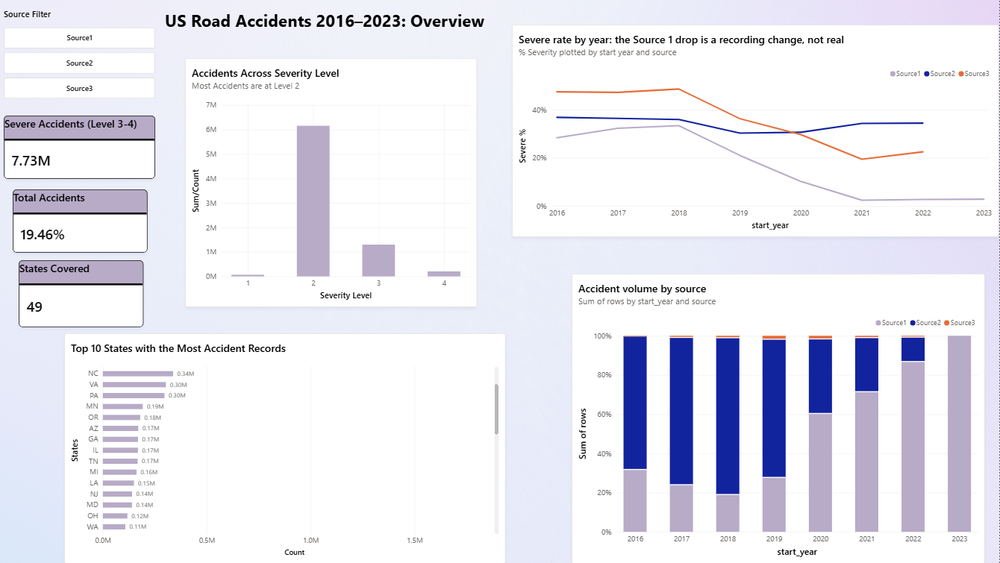

# US Accidents: Predicting Severe Road Accidents

**Question:** which weather, time and road features predict whether a US road accident will be severe, so authorities can target warnings and resources?

**Data:** [US Accidents 2016–2023](https://www.kaggle.com/datasets/sobhanmoosavi/us-accidents) (Kaggle), 7.7 million rows.
**Tools:** Python (pandas, scikit-learn, XGBoost), SQL, Power BI.

## Results (validation set)

Target: severe = severity 3 or 4 (34% of rows), so I judge models on F1 and PR-AUC, not accuracy.

| Model | Precision | Recall | F1 | PR-AUC |
|---|---|---|---|---|
| Baseline (random) | – | – | – | 0.34 |
| Decision tree | 0.78 | 0.69 | 0.73 | 0.82 |
| **XGBoost** | **0.82** | **0.76** | **0.79** | **0.87** |

Train and validation scores are within 0.3 points, so neither model is overfitting. The test set is held back until the model is final.

## What I found

1. **The label changed, not the roads.** Severe accidents appeared to fall from 36% (2016) to 3% (2023). Splitting by data provider showed each provider graded severity differently and two changed their grading over time. I kept the one stable provider (Source2, 3.3M rows).
2. **Mixing providers hid real effects.** On the full data, snow looked harmless. Within Source2 it is the biggest weather effect (44% severe vs a 34% baseline).
3. **Road type dominates.** 15% of local-road accidents are severe vs 80% on interstates. It carries 64% of the decision tree's importance.
4. **Many road features were really road-type effects.** Give-way signs and speed bumps showed a 16-point gap that disappeared once road type was held fixed.
5. **Where the model fails:** false alarms on interstates, and a higher error rate overnight (about 24% vs 17% in the day).

## How it works

- **Cleaning:** Source2 only; 3,581 duplicates removed before splitting; impossible values set to missing using physical limits; 336k street names grouped into 8 road types with regex; 145 weather descriptions turned into yes/no flags.
- **No leakage:** dropped anything only known after an accident clears (end time, duration, distance affected, description).
- **Split:** 60/20/20 train/validation/test; median imputation fitted on train only.
- **Models:** decision tree and XGBoost as reusable classes in `src/`, plus an error-analysis class that breaks mistakes down by feature.

## Dashboard

A three-page Power BI dashboard of the EDA for non-technical readers: [dashboard_viz/](dashboard_viz/)



## Repository

| Path | What it does |
|---|---|
| `notebooks/eda.ipynb` | Profiling, relationships with severity, the Source2 decision |
| `notebooks/dcdm.ipynb` | Cleaning, features, split, imputation |
| `notebooks/model.ipynb` | Training, evaluation, error analysis |
| `src/` | Decision tree, XGBoost and error-analysis classes |
| `notes.txt` | Step-by-step EDA notes |

## Run it

```
python -m venv venv
venv\Scripts\activate        # Mac/Linux: source venv/bin/activate
pip install -r requirements.txt
```

Run `eda.ipynb`, then `dcdm.ipynb`, then `model.ipynb`. The first notebook downloads the data with kagglehub (Kaggle account needed).

## Next steps

- Tune XGBoost and choose a decision threshold from the precision-recall curve.
- Redo the cleaning in SQL.
- Score the test set once the model is final.
