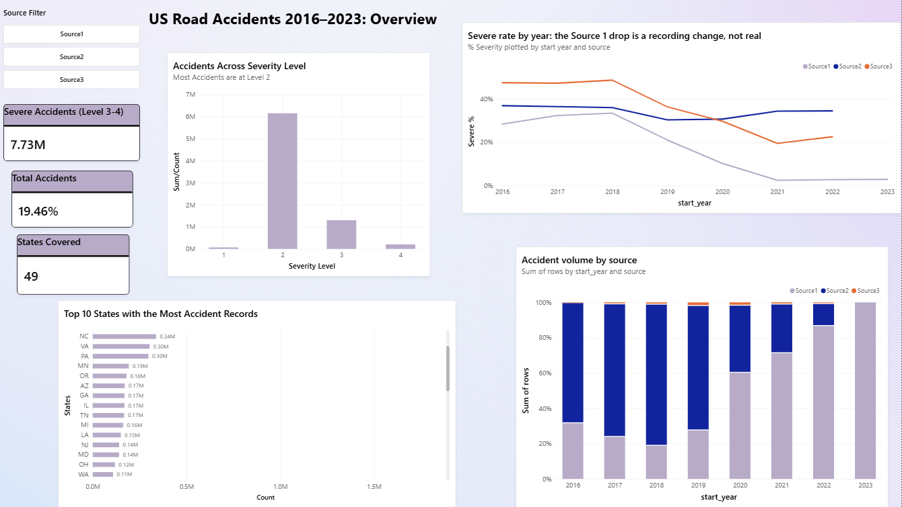
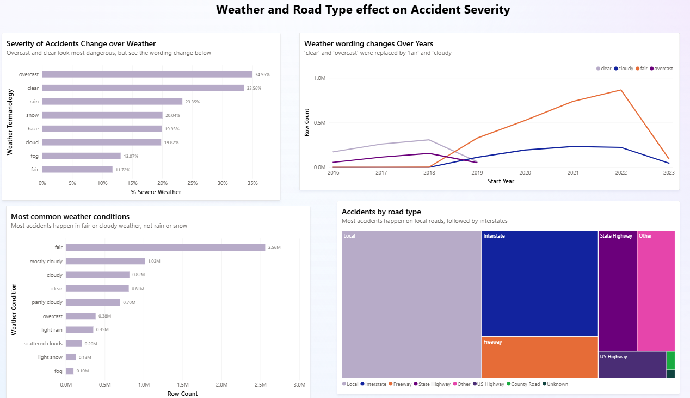
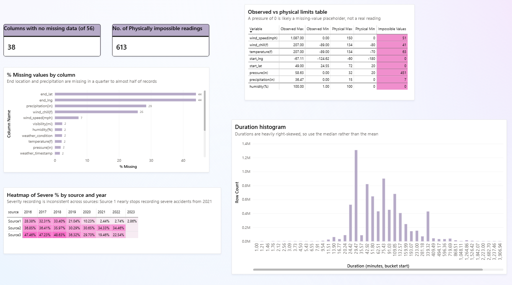

# US Accidents: Predicting Severe Road Accidents

Question: which weather, time-of-day and road features best predict whether a US road accident will be severe, so authorities can target warnings and resources?

End-to-end project on the Kaggle [US Accidents (2016-2023)](https://www.kaggle.com/datasets/sobhanmoosavi/us-accidents) dataset (7.7 million rows, 46 columns). It covers exploratory analysis, cleaning, feature engineering, tree-based classification and error analysis, plus a Power BI dashboard of the EDA.

## Results (validation set)

Target: severe = severity 3 or 4. 34% of rows are severe after cleaning, so accuracy is shown for reference only. Precision, recall, F1 and PR-AUC are the metrics that matter.

| Model | Precision | Recall | F1 | PR-AUC | Accuracy |
|---|---|---|---|---|---|
| Baseline | - | - | - | 0.340 | 0.660 |
| Decision tree (depth 10, min leaf 500) | 0.783 | 0.689 | 0.733 | 0.822 | 0.830 |
| XGBoost (default settings) | 0.821 | 0.763 | 0.791 | 0.871 | 0.863 |

The baseline PR-AUC is what random guessing scores. The baseline accuracy is what you get by predicting "not severe" for every row.

- Train and validation scores are within 0.3 points of each other for both models, so neither is overfitting.
- The test set (660,051 rows) is held back and has not been scored yet.

Feature importance: road type carries 64% of the decision tree's importance, followed by location (longitude and latitude, 17% together) and the engineered constraint_count feature (7%). This matches the EDA, where road type was by far the strongest predictor.

Where the model goes wrong:

- Interstates: errors are almost all false alarms (16% of rows) rather than missed severe accidents (2%). About 80% of interstate accidents are severe, so the model tends to call them all severe.
- Local roads: the lowest error rate of any road type, at 13%.
- Overnight (00:00-03:00): error rate around 23-24%, against roughly 17% during the day.

## Key findings from the EDA

The EDA follows a staged framework (EXPLORED): establish the question, examine the structure, purify, look at each variable, observe relationships, root out anomalies, engineer and transform, document and decide. Full step-by-step notes are in [notes.txt](notes.txt).

1. The severity label is not consistent across the dataset. Two words for the same weather, "clear" and "fair", differed in severe rate by 21.8 points. Tracing that showed the weather wording changed at the end of 2019, and that the severe rate fell twelvefold from 2016 to 2023 (35.6% to 2.9%). Broken down by data provider:

| Year | Source1 | Source2 | Source3 |
|---|---|---|---|
| 2016 | 28.4% | 36.8% | 47.5% |
| 2019 | 21.0% | 30.3% | 36.3% |
| 2022 | 2.7% | 34.5% | 22.5% |

Each provider graded severity differently, and two of them changed their grading over time. Only Source2 is stable, so the analysis uses Source2 only (3.3 million rows). After that restriction the clear/fair gap fell from 21.8 to 4.6 points, which confirmed the decision.

2. Mixing the sources hid or reversed real effects. On the full dataset, snow appeared to have no effect (20.0% severe against a 19.5% baseline). Within Source2 it is the largest weather effect: 44.2% against a 33.9% baseline. Night-time and hour-of-day effects were also reversed.

3. Road type dominates. The severe rate ranges from 14.7% on local roads to 80.4% on interstates.

4. Many road-feature effects were really road-type effects. Comparing each of the 12 road-feature flags within the same road type showed:

- Real effects (lower severity): traffic signals, crossings, stop signs, amenities and stations. All mark places where traffic is already slow.
- No real effect: give-way signs and speed bumps. Their raw gap of up to 16 points disappeared once road type was held fixed.
- Real effect, opposite direction: junctions, with four times the severe rate on local roads.

5. Leakage removed. End time, duration, end coordinates, distance affected and the free-text description are only known after an accident has cleared, and they measure the size of the disruption, which is what severity is. They were excluded as features.

## Data cleaning and feature engineering

- Source restriction: Source2 only, for consistent labelling.
- Duplicates: 3,581 exact duplicates removed before the split, so no copy lands in both train and test.
- Impossible values: set to missing using physical limits (for example temperature -70 to 134 F, pressure 20-32 inHg). IQR rules were not used because at this size they flag millions of real values.
- street_type: 336,306 unique street names reduced to 8 road classes using regex.
- Weather flags: 145 free-text weather descriptions turned into yes/no flags (rain, snow, ice, thunder, fog, obscured, windy).
- is_night: the four twilight columns were tested, and only full darkness changed severity, so they became one flag.
- constraint_count: how many slow-traffic features are present (signal, crossing, stop, amenity, station).
- weather_missing: kept as a flag, because accidents with no weather reading were 2.5-11.4 points more likely to be severe.
- Dropped: constant columns, high-cardinality location columns (zipcode, city, county), wind chill (correlated with temperature) and precipitation (47% missing).
- Split: 60/20/20 train/validation/test, random_state=42.
- Imputation: median, fitted on train only, then applied to validation and test.

Final dataset: 3,300,253 rows (1,980,151 train, 660,051 validation, 660,051 test).

## Dashboard

A Power BI dashboard summarising the EDA: [dashboard_pages1_2_3.pbix](dashboard_viz/dashboard_pages1_2_3.pbix)






## Repository structure

- notebooks/eda.ipynb: column profiling, relationships with severity, the Source2 decision
- notebooks/dcdm.ipynb: data cleaning, feature matrix, train/validation/test split, imputation
- notebooks/model.ipynb: decision tree and XGBoost training, evaluation and error analysis
- src/decision_tree.py: decision tree class (train, score, precision-recall curve)
- src/xgboost.py: XGBoost class with the same interface
- src/classification_error_analysis.py: confusion counts, per-class report, errors broken down by feature
- dashboard_viz/: Power BI file and page images
- requirements.txt

## How to run

```
python -m venv venv
venv\Scripts\activate
pip install -r requirements.txt
```

On Mac or Linux, activate with `source venv/bin/activate`.

Run the notebooks in order: eda.ipynb, then dcdm.ipynb, then model.ipynb. The first notebook downloads the dataset with kagglehub (you need a Kaggle account). Each notebook saves its output as parquet files in data/, which is not committed to the repo.

## Limitations and next steps

- Results apply to Source2's grading only. A planned check is to re-test the main findings on Source1's stable 2016-2018 years.
- Rows are split at random rather than by date, so the validation score doesn't show performance on future years.
- XGBoost uses default settings and both models use a 0.5 threshold. Next: tune on validation and choose a threshold from the precision-recall curve, based on the cost of a missed severe accident versus a false alarm.
- The weather flags have almost no importance in the decision tree, despite clear effects in the EDA. This needs investigating. A likely cause is that the flags are rare and road type takes most of the splits.
- Planned: move the cleaning steps from notebooks into a class-based pipeline in src/, then score the test set once.